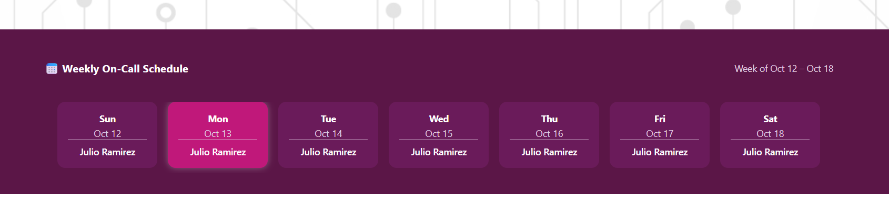

# 🧭 Vibe Codes SPFx On-Call Schedule Web Part

A modern **SharePoint Framework (SPFx)** web part that dynamically displays the **IT On-Call Schedule** from a shared Outlook calendar using **Microsoft Graph API**.  
Built to enhance internal visibility of on-call coverage for IT staff and other departments, this solution automatically syncs with the organization's centralized calendar — ensuring that employees always see an up-to-date on-call rotation directly in SharePoint.

---

## 🚀 Features

- **Dynamic Microsoft Graph Integration**  
  Automatically retrieves events from the shared IT On-Call calendar (`it-oncall@cvch.org`).

- **Real-Time Weekly View**  
  Displays a live week-by-week view of current and upcoming on-call assignments.

- **Responsive UI**  
  Fully adaptive layout that fits both desktop and mobile views, with smooth scroll and current-day highlighting.

- **Center-Aligned, Full-Width Aesthetic**  
  Designed with a branded gradient and balanced spacing for a professional internal dashboard appearance.

- **Secure Permissions**  
  Uses delegated Graph permissions (`Calendars.Read`, `Calendars.Read.Shared`) via `package-solution.json` for secure data access.

---

## 🖼️ Example



---

## 🧩 Tech Stack

| Component | Description |
|------------|-------------|
| **SPFx 1.20+** | Framework used for the SharePoint client-side solution |
| **React 18** | UI layer for rendering the dynamic schedule grid |
| **Microsoft Graph (v3)** | API endpoint for fetching shared calendar data |
| **TypeScript** | Strongly-typed logic and interfaces for safer coding |
| **date-fns** | Lightweight date manipulation utilities for weekly logic |

---

## ⚙️ Installation & Deployment

1. **Clone the repository**
   ```bash
   git clone https://github.com/jayrez/spfx-oncall-schedule.git
   cd spfx-oncall-schedule
   ```

2. **Install dependencies**
   ```bash
   npm install
   ```

3. **Run the local workbench**
   ```bash
   gulp serve
   ```
   Open in browser:  
   `https://yourtenant.sharepoint.com/_layouts/15/workbench.aspx`

4. **Build & package for deployment**
   ```bash
   gulp bundle --ship
   gulp package-solution --ship
   ```

5. **Upload to the App Catalog**
   - Go to:  
     `https://yourtenant.sharepoint.com/sites/appcatalog/AppCatalog/Forms/AllItems.aspx`
   - Upload `oncall-schedule.sppkg`
   - Approve the Graph API permissions when prompted (`Calendars.Read`, `Calendars.Read.Shared`)

6. **Add the web part to a SharePoint page**
   - Edit a modern page  
   - Select **Add a Web Part → On-Call Schedule**  
   - Publish and enjoy live schedule syncing 🎉

---

## 💡 Use Case

Designed for IT operations teams that maintain rotating on-call schedules, this web part centralizes that visibility in SharePoint.  
It eliminates manual updates or duplicated lists — automatically syncing directly from Outlook 365 Calendar data using Microsoft Graph.

---

## 👨‍💻 Author

**Julio Ramirez**  
Senior System Administrator & IT Operations Lead  
[GitHub: @jayrez](https://github.com/jayrez)

---

## 📝 License

This project is open-source under the [MIT License](LICENSE).
